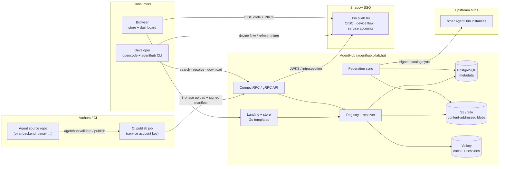
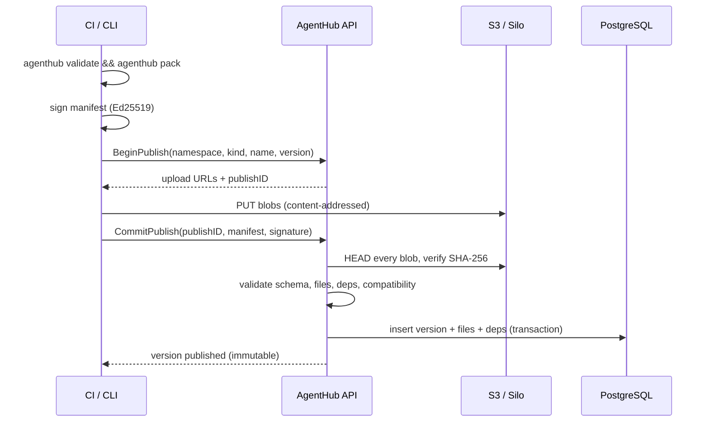
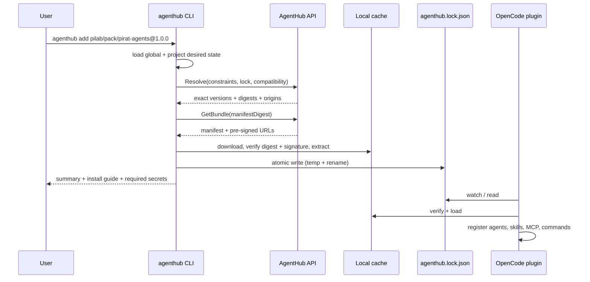
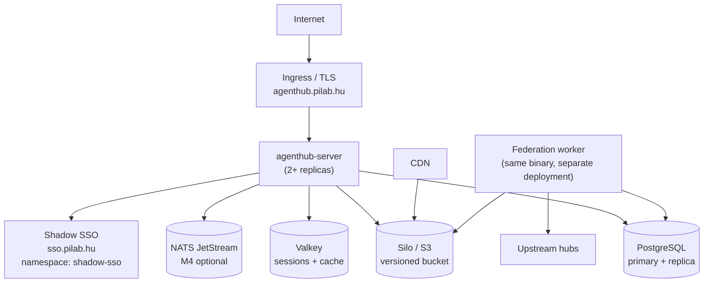

# AgentHub Architecture

**Status:** Draft v0.1 · **Date:** 2026-11-04 · **Owner:** PiLab
**Domain:** `agenthub.pilab.hu` · **Module:** `go.pilab.hu/agenthub`

---

## 1. Summary

AgentHub is a **package registry and control plane for AI-agent assets**. It stores
versioned *agents*, *skills*, *tools*, *prompts*, and *packs*; publishes them with
install guides, permission manifests, and signatures; and distributes them to
developer machines through a CLI and an OpenCode V2 plugin.

The design separates four things that are usually mixed together:

1. **Desired state** — `agenthub.json`: what the project/user wants.
2. **Resolved state** — `agenthub.lock.json`: exact versions, origins, and digests.
3. **Content state** — a content-addressed local cache: verified bytes.
4. **Runtime state** — what OpenCode actually loads: agents, skills, MCP servers,
   commands, and tools registered by the plugin.

That separation is what makes installs deterministic, offline-capable, auditable,
and reversible. It also lets a pack be consumed by multiple harnesses later
without redefining the assets.

### What it is not

- **Not an execution runtime.** PiR@'s orchestrator decides when and where an
  agent runs. AgentHub only provides the definition.
- **Not a model provider.** It records model *preferences* and *fallbacks*, but
  the user's OpenCode configuration decides which models are available.
- **Not a Git host.** Source repositories remain the authoring home; AgentHub
  stores built, immutable bundles.
- **Not a secrets manager.** Tool assets declare secret *placeholders*; values
  come from environment variables, OpenCode integrations, or the user's secret
  manager.
- **Not a payment marketplace in v1.** "Store" means catalog + install UX.

---

## 2. Goals and non-goals

### Goals

| ID | Goal | Measure |
| --- | --- | --- |
| G1 | Publish any agent/skill/tool/prompt as an immutable, signed version | 100% of public versions have a digest and a verified signature |
| G2 | Install deterministically and offline | `agenthub install --frozen` succeeds from cache with the network down |
| G3 | Zero manual file copying for OpenCode V2 users | One CLI command + plugin; no edits to `opencode.json` required |
| G4 | Show the blast radius before install | Every asset page lists permissions, MCP servers, scripts, and dependencies |
| G5 | Reuse PiLab identity | No passwords or user tables; Shadow SSO only |
| G6 | Federate without losing provenance | Lockfiles always retain origin hub, version, and digest |
| G7 | Keep the MVP small | Single server binary, Postgres + S3, no mandatory NATS/Valkey/Meilisearch |

### Non-goals (v1)

- Running agents, sandboxing them, or streaming their logs.
- Storing model weights or provider credentials.
- Arbitrary `postinstall` scripts. This is a hard rule, not a preference.
- A general-purpose OCI registry. The bundle format is intentionally small.
- Cross-harness perfect fidelity. OpenCode V2 is the reference adapter; Claude
  Code/Codex/Cursor adapters are best-effort and marked as lossy.

---

## 3. Glossary

| Term | Meaning |
| --- | --- |
| **Hub** | One AgentHub deployment, identified by its DNS name (`agenthub.pilab.hu`) |
| **Space / namespace** | A publishing tenant inside a hub (`pilab`, `pirat`, `pimail`, `alice`) |
| **Asset** | A stable identity: `(hub, namespace, kind, name)` |
| **Version** | One immutable release of an asset (SemVer 2.0) |
| **Bundle** | The tar.zst payload of a version: files + generated manifest |
| **Manifest** | Canonical, signed JSON describing one version |
| **Pack** | An asset whose members are other assets with version constraints |
| **Origin** | The hub where a version was first published |
| **Upstream** | Another hub that this hub federates with |
| **Install guide** | Per-harness, per-scope Markdown instructions, validated in CI |
| **Lockfile** | The resolved, pinned install plan written by the CLI |
| **Managed mode** | CLI writes only config/lock/cache; the plugin registers assets at runtime |
| **Portable mode** | CLI materializes files into `.opencode/` for use without the plugin |

---

## 4. Design principles

1. **Immutable versions, mutable pointers.** A published version never changes.
   `latest`, tags, and channels are pointers, resolved and pinned in the lockfile.
2. **Desired state, not commands.** The CLI reconciles `agenthub.json` to a
   lockfile and cache. `agenthub add` is a state change, not a one-shot copy.
3. **Content-addressed everything.** Manifests, bundles, icons, and individual
   files are addressed by SHA-256. Mirrors cannot alter content without breaking
   the lockfile.
4. **Signatures are not optional for public installs.** The default policy is
   `requireSignature: true`; unverified installs require an explicit opt-in.
5. **No executable install hooks.** Guides are Markdown. Tools are configuration
   descriptors. Nothing runs during install.
6. **Canonical model + adapters.** The hub stores harness-neutral assets; the
   OpenCode adapter translates to V2. Lossy translations are visible to the user.
7. **Least privilege by default.** Agents are registered with a deny-all rule
   followed by explicit allows; global OpenCode allow rules cannot silently
   broaden a hub agent.
8. **Local-first.** Search results, manifests, and bundles are cached. The plugin
   starts from the lockfile and cache without waiting for the network.
9. **Federate by identity and digest.** Names may collide; `(origin, namespace,
   kind, name, version, digest)` does not. Resolution never silently substitutes.
10. **Identity is delegated.** Shadow SSO owns authentication, MFA, sessions,
    clients, and service accounts. AgentHub owns namespace authorization.

---

## 5. System context



### Trust boundaries

| Boundary | Control |
| --- | --- |
| Browser → hub | TLS, OIDC session, CSRF, host-only cookies |
| CLI/plugin → hub | TLS, Bearer JWT (audience `agenthub`) |
| CI → hub | Service account JWT (private-key JWT), scoped audience, namespace role |
| Hub → upstream | mTLS (optional) + service-account token + signed catalog |
| Hub → Postgres/S3 | private network, least-privilege credentials, encryption at rest |
| Hub → Shadow SSO | TLS, JWKS, short token TTL, introspection for revocation |

---

## 6. Components

### 6.1 `agenthub-server` (Go)

One deployable binary with subcommands `serve`, `migrate`, and (from M4)
`worker`. Responsibilities:

- Serve the public landing page, store, and authenticated dashboard
  (server-rendered), including dynamic agent cards.
- Act as the OIDC BFF for Shadow SSO: code + PKCE, server-side tokens, session
  cookie; the browser never holds tokens.
- Manage web drafts and publish them with a hosted namespace key (opt-in) or
  hand them to the CLI for client-side signing.
- Serve ConnectRPC/gRPC catalog, registry, identity, and federation services.
- Serve immutable blob and bundle downloads (pre-signed S3 URLs).
- Serve the OpenCode **skills HTTP catalog** (`/opencode/skills/index.json`).
- Validate, sign-check, store, and index published versions.
- Run federation sync jobs.
- Expose `/healthz`, `/readyz`, `/metrics`.

### 6.2 `agenthub` CLI (Go)

The only mutator of local state:

- Authenticate via Shadow SSO device flow or a service-account key.
- Search, inspect, resolve, install, update, remove, verify, and export.
- Validate, pack, sign, and publish bundles.
- Manage desired state (`agenthub.json`) and resolved state (`agenthub.lock.json`).
- In managed mode, write **nothing** into OpenCode's config; the plugin reads the
  lockfile and cache.
- In portable mode, materialize files into `.opencode/` for harnesses without the
  plugin.

### 6.3 `@pilab/opencode-agenthub` (TypeScript, OpenCode V2)

The runtime adapter:

- Reads the lockfile and verifies cached content.
- Registers agents, skills, MCP servers, commands, and instruction hooks.
- Exposes `agenthub_search`, `agenthub_info`, `agenthub_status`, and
  `agenthub_add` tools (mutations delegate to the CLI).
- Watches the lockfile and re-applies transforms.
- Enforces local policy (signature required, deny-listed permissions, no
  auto-update).

### 6.4 Store / landing (Go templates)

- `/` marketing landing: value proposition, featured packs, quick install, and
  a **New agents** grid of the latest published public agents. Cards are
  server-rendered from PostgreSQL and refreshed after every publish.
- `/partials/landing/agents` HTMX partial for the card grid; `/api/v1/landing/agents`
  JSON equivalent for an external frontend.
- `/store` catalog with filters and server-rendered search.
- `/store/{namespace}/{kind}/{name}` asset detail with versions, permissions,
  files, dependencies, install guide tabs, changelog, and signature status.
- `/publishers/{namespace}` publisher page.
- `/docs` install and publishing guides.
- `/dashboard` authenticated namespace/asset/audit view.

### 6.5 Data stores

| Store | Data | Why |
| --- | --- | --- |
| PostgreSQL | namespaces, assets, versions, manifests, files, dependencies, keys, upstreams, audit | Relational queries, transactions, FTS |
| S3/Silo | bundle tarballs, individual blobs, icons, guides | Immutable, CDN-friendly, cheap |
| Valkey | sessions, hot manifests, resolve cache, rate-limit counters | Low-latency reads; optional at MVP |
| NATS JetStream | federation sync jobs, index events, webhooks | M4; decouples slow work |

---

## 7. Core flows

### 7.1 Publish (two-phase, signed)



Key properties:

- Blobs are uploaded directly to S3; the API never buffers large files.
- `CommitPublish` is idempotent by `(asset, version, manifestDigest)`.
- The server re-validates everything; client-side validation is only a fast fail.
- A version can be yanked or deprecated, never edited or re-uploaded.

### 7.2 Install (CLI reconcile)



### 7.3 Runtime load (plugin)

1. On `setup`, load `agenthub.json` (global then project) and the matching lockfile.
2. If the cache is complete and signatures verify, register immediately; do not
   block on the network.
3. Register in this order: MCP servers → skills → commands → agents → instruction
   hooks. Dependencies are registered before dependents.
4. If the registry is reachable and update checks are enabled, check in the
   background; never auto-install.
5. On lockfile change, dispose the old registrations, reload the cache, and
   re-register. This keeps OpenCode's agent/skill/MCP state in sync without a
   restart.

### 7.4 Federation sync (M4)

1. Fetch upstream `/.well-known/agenthub.json` (hub ID, keys, endpoints, protocol).
2. Fetch signed catalog pages since the stored cursor.
3. Verify the hub signature and each asset signature; upsert metadata.
4. In `mirror` mode, fetch bundles and blobs; verify digests; store origin metadata.
5. Record tombstones for yanks/deletes. Never silently delete a blob referenced by
   a retained lockfile window.
6. Search remains local-first; a failed upstream never blocks local results.

### 7.5 Web create → landing card

1. The user signs in through Shadow SSO (`agenthub-web`, authorization code +
   PKCE); the Go server acts as the BFF and keeps tokens server-side.
2. `GET /dashboard/{namespace}/agents/new` renders the form.
3. `POST /dashboard/{namespace}/agents` validates and stores an owner-only draft.
4. `POST /dashboard/{namespace}/agents/{name}/publish` either:
   - signs with the namespace's hosted key (OpenBao Transit) and publishes
     immediately, or
   - returns `409 HOSTED_SIGNING_DISABLED` with the exact `agenthub publish`
     command for client-side signing.
5. A successful publish updates `assets.latest_version`, bumps the catalog
   revision, invalidates the landing cache, and writes an audit event.
6. The landing page query renders published public agents newest-first; the card
   appears on the next page load or on the 30-second HTMX poll. Drafts, private
   namespaces, and unlisted assets never appear.

The full web flow, OIDC client configuration, and Shadow SSO Kubernetes
deployment are in [web-and-sso.md](docs/architecture/web-and-sso.md).

---

## 8. Domain model (summary)

Full schemas and examples: [domain-model.md](docs/architecture/domain-model.md).

### Asset identity

```text
agenthub://<hub>/<namespace>/<kind>/<name>@<version>

agenthub://agenthub.pilab.hu/pilab/agent/code-reviewer@1.4.0
agenthub://agenthub.pilab.hu/pirat/pack/pirat-agents@1.0.0
```

CLI shorthand (resolved against configured registries, then pinned in the lock):

```text
pilab/agent/code-reviewer@^1.4
pirat/pack/pirat-agents
```

### Asset kinds

| Kind | Payload | OpenCode V2 mapping |
| --- | --- | --- |
| `agent` | prompt + frontmatter (mode, model policy, permissions) | `ctx.agent.transform` upsert |
| `skill` | `SKILL.md` + supporting files | `ctx.skill.transform` add (or HTTP catalog) |
| `tool` | MCP server / plugin / CLI descriptor + install guide | `ctx.mcp.transform` or guide-only |
| `prompt` | template + variables + target (`command`, `instruction`, `system`) | `ctx.command.transform` / `ctx.session.hook("context")` |
| `pack` | members + optional extras + routing metadata | resolved into the above |

### Version and status

- SemVer 2.0; pre-releases are opt-in.
- Status: `draft` → `published` → `deprecated` → `yanked`.
- Yank hides from search and new resolutions but keeps existing lockfiles
  downloadable for a configurable retention window.
- Every version has `manifestDigest` and `bundleDigest`; every file has a SHA-256.

### Permissions

Canonical permissions use OpenCode V2's expressive rule shape:

```yaml
permissions:
  - action: "*"
    resource: "*"
    effect: deny
  - action: read
    resource: "*"
    effect: allow
  - action: shell
    resource: "git status"
    effect: allow
```

The first rule is always an explicit deny-all. Adapters append allows after it, so
a global OpenCode allow rule cannot silently grant more power to a hub agent.

---

## 9. API surface (summary)

Full proto sketches: [api.md](docs/architecture/api.md).

| Service | Purpose |
| --- | --- |
| `CatalogService` | search, get, list versions, resolve, get bundle, install guides, watch |
| `RegistryService` | namespaces, begin/commit publish, validate, yank, deprecate, drafts |
| `FederationService` | hub info, catalog sync, upstream management, export/import |
| `IdentityService` | whoami, namespaces/roles, token metadata |

Protocol choice: **ConnectRPC** generated by `buf`, serving Connect, gRPC, and
gRPC-Web from one Go handler. This matches the PiLab ecosystem (`pirat`,
`shadow-sso`) and lets the TypeScript plugin and browser use plain `fetch` while
native gRPC clients still work. Blob downloads are HTTP, not gRPC.

---

## 10. Authentication and authorization (Shadow SSO)

`auth` is delegated entirely to **Shadow SSO** (`https://sso.pilab.hu`). AgentHub
stores no passwords and implements no MFA.

| Client | Flow | Use |
| --- | --- | --- |
| `agenthub-web` | OIDC authorization code + PKCE, server-side token exchange | Store login, dashboard; frontend and backend share this BFF client |
| `agenthub-cli` | OAuth 2.0 device authorization + refresh | `agenthub login` |
| `agenthub-ci` | Service account: `client_credentials` grant authenticated with `private_key_jwt` | CI publishing |
| `agenthub-federation` | Service account with audience = peer hub | Hub-to-hub sync |

- Access tokens are JWTs validated locally against Shadow SSO's JWKS, with
  `iss`, `aud` against an allowlist (client ID for user tokens, `agenthub` for
  service accounts), `exp`/`nbf`, and algorithm checks.
- Revocation uses short TTLs plus introspection for high-risk operations.
- Namespace roles come from SSO groups: `agenthub:<namespace>:<role>`
  (`reader`, `publisher`, `maintainer`, `owner`).
- Scopes are coarse: `agenthub.read`, `agenthub.publish`, `agenthub.admin`,
  `agenthub.federation`.
- Public catalog reads are anonymous; private spaces require a reader role.
- CI never uses a human token. Service-account keys are scoped to one audience
  and one namespace role.
- The browser never receives access or refresh tokens: the Go BFF exchanges the
  code, stores tokens server-side, and issues an opaque `HttpOnly` session
  cookie. A separate SPA would need the optional public `agenthub-spa` client.

Details, client configuration, claims mapping, and validation rules:
[api.md](docs/architecture/api.md#5-authentication-and-authorization) and
[web-and-sso.md](docs/architecture/web-and-sso.md).

---

## 11. Deployment topology



- **MVP:** single region, one server deployment, Postgres + S3 + optional Valkey.
- **Growth:** separate federation worker, read replica, CDN for blobs, Meilisearch.
- **Air-gapped:** mirror mode + signed export/import bundles.

Operations, SLOs, backups, and runbooks: [operations.md](docs/architecture/operations.md).

---

## 12. Security model

### Supply chain

- Publisher signs the canonical manifest with an Ed25519 key bound to the namespace.
- The server verifies the signature at publish time; clients verify again at install.
- The lockfile pins `origin`, `manifestDigest`, and `bundleDigest`.
- The store displays: verified publisher, signature key, permissions, MCP servers,
  executable files, dependencies, license, and source repository.
- No install hooks. Scripts inside skills/tools are visible and never executed by
  the installer.
- Optional: Sigstore keyless signing, transparency log, SBOM/provenance (phase 3).

### Prompt supply chain

Agents are instructions plus permissions. A malicious agent can still attempt
prompt injection or data exfiltration. Mitigations:

- Permission manifests are shown before install and enforced after.
- Agents are deny-all by default; shell/network/external-directory access is explicit.
- The plugin refuses to auto-enable an asset that requests new high-risk
  permissions after an update; the CLI reports a policy diff.
- Verified publishers and namespace ownership are visible; unverified assets are
  opt-in.
- Secrets are never stored in assets; placeholders are validated and resolved from
  the environment at runtime.

### Application security

- TLS everywhere; HSTS; secure, host-only cookies; CSRF double-submit.
- Upload validation: path traversal, symlinks, absolute paths, zip bombs, size
  limits, MIME sniffing, executable-bit policy.
- Rate limits per IP, principal, namespace, and operation.
- Audit log for publish, yank, key changes, namespace changes, and admin actions.
- Hosted publisher keys live in OpenBao Transit/KMS, are scoped to one namespace,
  and are usable only by the web publish use case.
- Dashboard drafts are owner-only until published; landing cards are generated
  only from published public versions.
- Dependency and container scanning in CI; signed releases.

---

## 13. Roadmap

| Phase | Scope | Exit criteria |
| --- | --- | --- |
| **M0 — Skeleton** | Go module, buf, Postgres migrations, health, CI, Docker | `make test` and `buf lint` pass; server starts |
| **M1 — Publish & read** | namespaces, bundles, signing, catalog API, store pages | A signed pack is published and browsable |
| **M2 — Consume** | CLI resolve/install/lock/verify, OpenCode V2 plugin | `agenthub add` + `opencode` loads the pack; offline install works |
| **M3 — Operate** | Shadow SSO, RBAC, audit, rate limits, observability, deploy | Public hub live at `agenthub.pilab.hu` |
| **M4 — Federate** | upstream sync, reference/mirror/proxy, export/import | Two hubs exchange a signed pack; mirror works offline |
| **M5 — Ecosystem** | more harness adapters, ratings, recommendations, Sigstore | Non-OpenCode install path is documented and tested |

Detailed delivery slices and test strategy: [operations.md](docs/architecture/operations.md).

---

## 14. Decision log

| # | Decision | Rationale | Revisit when |
| --- | --- | --- | --- |
| D1 | Monorepo: Go server/CLI + TS plugin | Shared manifest schemas, atomic versioning, one CI | Plugin needs an independent release cadence |
| D2 | ConnectRPC over plain gRPC | Browser + Node + Go clients, same handler, gRPC compatible | A client requires a gRPC-only feature |
| D3 | Postgres + S3, not OCI | Simpler bundle format, easier federation, content addressing | OCI ecosystem integration becomes a requirement |
| D4 | Shadow SSO only | No duplicate identity/MFA; device flow and service accounts already exist | A standalone/offline IdP is required |
| D5 | CLI mutates, plugin observes | One installer implementation; plugin stays safe and fast | Plugin must work without the CLI installed |
| D6 | Managed mode by default | No file collisions, no config edits, atomic enable/disable | Users need non-OpenCode harnesses |
| D7 | Ed25519 namespace signatures | Simple, fast, offline-verifiable | Keyless/OIDC signing becomes mandatory |
| D8 | No install scripts | Supply-chain safety; assets are declarative | Never |
| D9 | Go SSR store | SEO, speed, one binary, no Node build in prod | Store needs rich client-side interactivity |
| D10 | Reference federation first | Low operational cost; mirrors only when needed | Air-gapped/private deployments dominate |
| D11 | Module path `go.pilab.hu/agenthub`; one hub deployment | Confirmed with the owner | Never |
| D12 | No `sisyphus-junior` asset | No Markdown definition and not needed; `pirat-task-agent` is canonical | A real definition and a clear role appear |
| D13 | PiMail `AGENTS.md` is `pimail`-scoped only | Repo-specific content with production details; not a general-purpose prompt | PiMail wants a reusable mail agent |
| D14 | Preserve imported shell permissions in v1 | Behavior parity first; tightening needs review | After the permission baseline is published |
| D15 | Web authoring uses opt-in hosted signing keys | Immediate publish from the dashboard without putting publisher keys in every browser; default remains CLI/CI client signing | Hosted custody is not acceptable for a namespace |
| D16 | Landing page shows newest published public agents | Creation must become visible without manual curation; drafts and private assets stay hidden | Editorial-only landing is required |
| D17 | One BFF OIDC client for frontend and backend | The server performs the code exchange; browser never holds tokens; matches the PiMail BFF pattern | The dashboard is split into a separate SPA |
| D18 | M1 ships handlers against an in-memory `Store` interface first | Faster iteration and testable without Postgres; handlers stay unchanged when Postgres repos land in M1.7 | Persistence or multi-instance correctness becomes a blocker |

---

## 15. Risks and mitigations

| Risk | Impact | Mitigation |
| --- | --- | --- |
| OpenCode V2 plugin/agent API changes | Runtime registration breaks | Thin adapter, capability detection, materialization fallback, pin tested OpenCode versions |
| Malicious agent/tool asset | Data exfiltration, destructive actions | Signatures, permission display, deny-all defaults, no auto-install, policy diff, verified publishers |
| Name collisions across hubs | Wrong asset installed | Full URNs in lockfile, explicit registry resolution, origin display |
| SSO outage | Login/publish unavailable | Public reads anonymous; JWKS cached; short outage tolerated; CLI keeps working offline |
| Model availability differs per user | Agent unusable or silently downgraded | `modelPolicy` with explicit fallbacks + `inherit`; show chosen model at runtime |
| Bundle/storage growth | Cost | Content-addressed dedupe, GC by refcount/retention, CDN |
| Federation complexity leaks into MVP | Delay | Federate only after M3; single-hub catalog is the default |
| Prompt injection remains unsolved | Trust erosion | Show full source, permissions, publisher; no claim of safety; user policy |

---

## 16. Target repository layout

```text
agenthub/
├── README.md
├── ARCHITECTURE.md
├── api/proto/agenthub/
│   ├── common/v1/common.proto
│   ├── catalog/v1/catalog.proto
│   ├── registry/v1/registry.proto
│   └── federation/v1/federation.proto
├── buf.yaml
├── buf.gen.yaml
├── cmd/
│   ├── agenthub/                 # CLI entrypoint
│   └── agenthub-server/          # server entrypoint
├── gen/go/                       # generated Go
├── gen/ts/                       # generated TypeScript
├── internal/
│   ├── domain/
│   ├── ports/
│   ├── app/
│   │   ├── catalog/
│   │   ├── registry/
│   │   └── federation/
│   ├── infrastructure/
│   │   ├── postgres/
│   │   ├── s3/
│   │   ├── valkey/
│   │   ├── nats/
│   │   ├── oidc/
│   │   ├── signing/
│   │   └── observability/
│   ├── api/
│   └── web/
├── pkg/
│   ├── manifest/
│   ├── lockfile/
│   └── semver/
├── clients/opencode-plugin/
├── migrations/
├── deploy/
│   ├── docker/
│   ├── compose/
│   └── k8s/
└── docs/architecture/
```

---

## 17. Documents

- [Domain model](docs/architecture/domain-model.md)
- [API and auth](docs/architecture/api.md)
- [Web app, landing page, and Shadow SSO](docs/architecture/web-and-sso.md)
- [CLI and plugin](docs/architecture/cli-plugin.md)
- [Federation](docs/architecture/federation.md)
- [Operations](docs/architecture/operations.md)
- [Importing existing agents](docs/architecture/importing-existing-agents.md)

## 18. Assumptions and confirmed decisions

1. `go.pilab.hu/agenthub` is the module path (confirmed); the hub is one
   deployment, not one deployment per tenant.
2. The store is a public catalog, not a paid marketplace, for v1.
3. Go server-rendered store is acceptable; no SPA build pipeline in v1.
4. `pirat-backend/agents/` is the authoring source of truth; the embedded
   `internal/agent/provision/agents/` copy will be generated or removed.
5. `pimail` contributes its `AGENTS.md` as a `pimail`-scoped, private instruction
   asset; it currently has no agent Markdown or `SKILL.md` files.
6. Shadow SSO is the only identity provider; local dev uses a docker-compose SSO.
