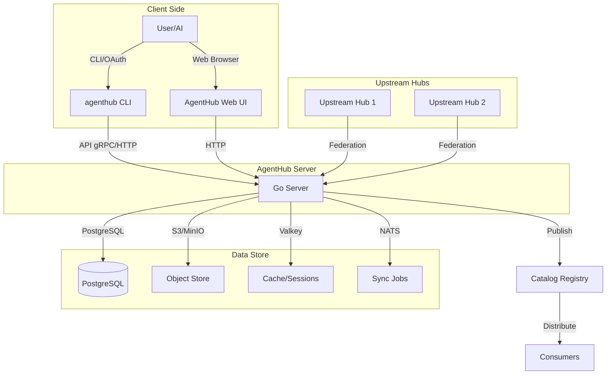

# Architecture Overview

## System Summary

**AgentHub** is the package registry and control plane for AI-agent assets: agents,
skills, tools, prompts, and packs. It publishes them with immutable versions,
install guides, permission manifests, and signatures; the CLI and the OpenCode V2
plugin install and run them from any machine.

AgentHub is **not** an execution runtime. Scheduling agent runs stays with the
PiR@ orchestrator; AgentHub only stores and distributes the assets those runs
consume.

## Core Planes

| Plane | Responsibility |
| --- | --- |
| **Catalog** | Search, browse, resolve, and download versioned agent assets |
| **Publishing** | Validate, sign, publish, deprecate, and yank versions |
| **Consumption** | CLI + OpenCode V2 plugin reconcile desired state into local runtime state |
| **Web** | Landing page, store, dashboard, and web-based agent creation |
| **Federation** | Mirror or reference assets from other hubs while preserving origin and signatures |

## Data Flow



## Key Components

### Server (Go 1.27)

- **Echo** HTTP framework
- **ConnectRPC** for gRPC-compatible RPC
- **Bun** ORM with goose migrations
- **zerolog** for structured logging
- **OpenTelemetry** for tracing
- **Prometheus** metrics

### CLI (Go + Cobra)

- Device flow Shadow SSO authentication
- Asset management (add, remove, publish, install)
- Lockfile management
- Federation sync

### Web Frontend

- Go `html/template` + Tailwind CSS
- HTMX for interactivity
- Shadow SSO integration
- Responsive design for mobile/desktop

### Protobuf / ConnectRPC

- Define services in `api/proto/`
- Generate Go code with `buf generate`
- ConnectRPC is gRPC-compatible but with explicit method definitions
- All API endpoints are versioned and authenticated

### Database (PostgreSQL via Bun)

- Schema defined in `migrations/` (goose migrations)
- Tables for hubs, namespaces, assets, versions, files, dependencies
- Bun provides type-safe queries + raw SQL fallback
- Migrations run via `agenthub migrate` CLI command

### Blobs (S3/MinIO/Silo)

- Content-addressed storage (SHA-256 digests)
- Store agent definitions, icons, readmes, bundles
- `max_bundle_bytes` configurable (default 64 MiB)
- `max_file_bytes` configurable (default 10 MiB)

### Cache (Valkey)

- Session storage
- Rate limiting data
- Short-lived computed values
- TTL-based expiration

### Events (NATS JetStream)

- Sync job coordination
- Asset change notifications
- Federation message passing
- Optional at MVP (M4)

### Identity (Shadow SSO)

- OIDC provider at `https://sso.pilab.hu`
- Device code flow for CLI authentication
- JWT bearer tokens for API authentication
- JWKS for key verification
- One-tap corner login support

### Plugin (OpenCode V2)

- `@opencode/plugin` integration
- Reads `agenthub.lock.json` to register assets
- Provides `@pilab/opencode-agenthub` TypeScript client
- Asset type support (agents, skills, tools, prompts, packs)

### Identity & Authentication

| Method | Used By | Description |
| --- | --- | --- |
| **Shadow SSO device flow** | CLI (`agenthub login`) | OIDC device code flow |
| **Bearer token** | API clients | `Authorization: Bearer <token>` |
| **Session cookie** | Web UI | Set after login |
| **Service accounts** | Backend-to-backend | JWKS-verified tokens |

### Federation

| Mode | Description |
| --- | --- |
| `reference` | Hub references upstream; assets resolved on-demand |
| `mirror` | Hub syncs assets from upstream periodically |
| `proxy` | Hub proxies requests to upstream, caches results |

### Observability

| Component | Purpose |
| --- | --- |
| **zerolog** | Structured JSON logging |
| **OpenTelemetry** | Traces across request boundaries |
| **Prometheus** | Metrics exposure (`/metrics` endpoint) |
| **Health endpoints** | `/healthz`, `/readyz` for Kubernetes |

### Deployment Architecture

```mermaid
graph LR
    subgraph "Kubernetes Cluster"
        subgraph "agenthub Namespace"
            PG[(PostgreSQL via CNPG)] 
            VC[Valkey]
            NS[NATS JetStream]
            S3[S3/MinIO Blob Store]
            AG[agenthub-server Deployment (2 replicas)]
            ING[Ingress (TLS via Let's Encrypt)]
        end
    end
    
    subgraph "External Services"
        SSO[Shadow SSO at sso.pilab.hu]
        DNS[DNS: agenthub.pilab.hu]
    end
    
    AG -->|SQL| PG
    AG -->|Cache| VC
    AG -->|Sync| NS
    AG -->|Blobs| S3
    AG -->|Auth| SSO
    ING -->|HTTPS| AG
    DNS -->|DNS| ING
```

## Versioning Scheme

AgentHub uses **semantic versioning** for assets and the server itself.

### Asset Versions

| Format | Example | Meaning |
| --- | --- | --- |
| `1.0.0` | Initial stable release |
| `1.1.0` | New features, backward compatible |
| `2.0.0` | Breaking changes |
| `1.0.0-beta.1` | Pre-release |
| `1.0.0-build-123` | Build metadata |

Server version follows a custom scheme: `20261105-r4` (date-based release).

### Compatibility

- **Within minor version**: Backward compatible (additive changes only)
- **Within major version**: Breaking changes possible
- **Cross-major**: Requires migration plan

### Version Pinning

Users pin exact versions in `agenthub.lock.json`:

```json
{
  "name": "my-agent",
  "version": "1.2.3"
}
```

Or use constraints:

```json
{
  "name": "my-agent",
  "version": "^1.0.0"
}
```

## Security Model

### Authentication

- **Shadow SSO** (OIDC) for human users
- **Bearer tokens** for API clients
- **Session cookies** for web UI
- **Service account keys** for backend-to-backend

### Authorization

- **RBAC** via `agency.namespace_roles` table
- **Roles**: `reader`, `publisher`, `maintainer`, `owner`
- **Per-namespace** bindings (hub + namespace + subject + role)
- **Fine-grained** actions: `read`, `publish`, `install`, `yank`

### Asset Security

- **Content-addressed** (SHA-256 digests)
- **Signed manifests** (ed25519)
- **Publisher custody** (keys managed per-namespace)
- **Audit logging** of all operations
- **Download counters** for analytics

### Data Security

- **PostgreSQL** with pg_hba.md5 auth
- **Valkey** with no auth in dev, production via Redis ACL
- **S3/MinIO** with bucket policies
- **TLS everywhere** (ingress via Let's Encrypt)
- **Environment isolation** via Kubernetes namespaces

## Roadmap Highlights

| Milestone | Target | Description |
| --- | --- | --- |
| **M0** | ✅ Skeleton | Server, CLI, migrations, health endpoints, metrics, CI/Docker |
| **M1** | Catalog | Resolve, get, list assets; basic CRUD |
| **M2** | Publishing | Full publish workflow, signatures, yank/deprecate |
| **M3** | Federation | Mirror/reference hubs, cross-hub asset resolution |
| **M4** | Events | NATS JetStream sync jobs, real-time updates |
| **M5** | Search | PostgreSQL full-text + Meilisearch adapter |
| **M6** | Web UI | Full dashboard, agent creation, SSO integration |
| **M6+** | Execution | Integration with PiR@ orchestrator for agent runs |

---

*For detailed milestone descriptions, see `docs/architecture/roadmap.md`.*
