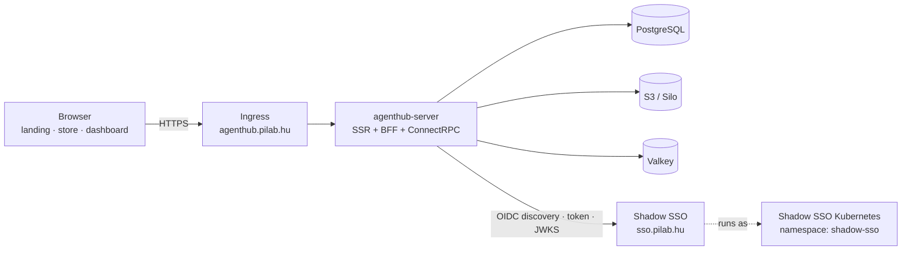

# Web App, Landing Page, and Shadow SSO

This document defines the browser-facing part of AgentHub:

- the landing page and the agent cards it renders;
- creating and publishing a new agent from the dashboard;
- how the frontend and backend authenticate through Shadow SSO;
- the Shadow SSO Kubernetes deployment that AgentHub depends on;
- the OIDC clients that must exist at `https://sso.pilab.hu`.

It complements [api.md](api.md), [domain-model.md](domain-model.md), and
[operations.md](operations.md). Where this document and the general API docs
overlap, this document is authoritative for the web flow.

---

## 1. Scope and default deployment

The default deployment is a **Go server that is both the frontend renderer and
the backend API** (a BFF — Backend For Frontend):



The Go server renders:

| Route | Purpose |
| --- | --- |
| `/` | Landing page with dynamic agent cards |
| `/store` | Full catalog with filters |
| `/dashboard` | Authenticated namespace and agent management |
| `/auth/*` | OIDC login, callback, logout |

The frontend and backend are one deployment in v1. They **share one OIDC
client**, `agenthub-web`, because the backend performs the authorization-code
exchange and holds the tokens. Both the frontend and backend use the same
Shadow SSO provider: the frontend starts the redirect, and the backend owns the
client secret, exchanges the code, and validates the ID token. The browser only
receives an opaque session cookie. This is the same pattern as PiMail's
`pimail-web-backend` BFF.

> **Why not two clients?** A browser SPA and a backend cannot share one
> authorization code: the client that starts the flow must also exchange the
> code. If the frontend is later split into a separate SPA, add the optional
> `agenthub-spa` public client described in §4.4. Do not put the confidential
> `agenthub-web` secret in browser JavaScript.

---

## 2. Shadow SSO in Kubernetes

Shadow SSO is deployed in the cluster as the `shadow-sso` release in the
`shadow-sso` namespace. AgentHub is a separate namespace and calls the SSO
public issuer.

### 2.1 Deployment shape

| Item | Value |
| --- | --- |
| Namespace | `shadow-sso` |
| Helm chart | `ssso-backend` |
| Release name | `shadow-sso` |
| `fullnameOverride` | `shadow-sso` |
| Backend Service | `shadow-sso.shadow-sso.svc.cluster.local:8080` |
| Management Service | `shadow-sso.shadow-sso.svc.cluster.local:5000` |
| Public issuer | `https://sso.pilab.hu` |
| Public ingress | `sso.pilab.hu` with TLS (`sso-pilab-hu-tls`) |
| Discovery | `https://sso.pilab.hu/.well-known/openid-configuration` |
| JWKS | `https://sso.pilab.hu/.well-known/jwks.json` |
| Database | external MongoDB; `SSSO_MONGO_URI` from OpenBao |
| Signing key | `sso-signing-key` Secret (`private.pem`) |
| Frontend | disabled in production; login UI is served by the backend |

Production values already set `frontend.enabled: false`, so the ingress routes
to the backend Service. If the Next.js frontend is enabled later, the same
ingress host routes to the frontend Service; AgentHub only needs the backend
OIDC endpoints either way.

### 2.2 Required Helm values

```yaml
# values-production.yaml (excerpt)
fullnameOverride: shadow-sso

ingress:
  enabled: true
  className: nginx
  annotations:
    cert-manager.io/cluster-issuer: letsencrypt-prod
  hosts:
    - host: sso.pilab.hu
      paths:
        - path: /
          pathType: Prefix
  tls:
    - secretName: sso-pilab-hu-tls
      hosts:
        - sso.pilab.hu

config:
  SSSO_ISSUER_URL: "https://sso.pilab.hu"
  SSSO_NEXTJS_LOGIN_URL: "https://sso.pilab.hu/login"
  # Only needed for a separate SPA that calls token/userinfo from JavaScript.
  # The default BFF flow is redirect-based and does not need CORS.
  # SSSO_ALLOWED_ORIGINS: '["https://agenthub.pilab.hu"]'
```

- `SSSO_ISSUER_URL` is the trust anchor. It must exactly match the `iss` claim
  in tokens; never set it to an in-cluster URL.
- `SSSO_ALLOWED_ORIGINS` is only needed if browser JavaScript calls token or
  userinfo endpoints directly. The BFF flow does not need CORS.
- The SSO container does not terminate TLS; the ingress does.

### 2.3 Secrets and OpenBao

Shadow SSO's production values inject two config secrets through the
Bank-Vaults/OpenBao webhook:

```text
secret/data/ShadowSSO#SSSO_MONGO_URI
secret/data/ShadowSSO#SSSO_CONFIG_ENCRYPTION_KEY
```

The remaining Kubernetes Secrets are created before rollout:

| Secret | Keys | Purpose |
| --- | --- | --- |
| `sso-signing-key` | `private.pem` | JWT signing key |
| `ssso-initial-admin-credentials` | admin email/password/first/last | First admin |
| `shadow-sso-frontend-secrets` | `SECRET_COOKIE_PASSWORD` | Only if frontend enabled |
| `ghcr-secret` | registry credentials | Image pull |

AgentHub stores the `agenthub-web` client secret in OpenBao, not in a
ConfigMap:

```text
secret/data/AgentHub#SSO_CLIENT_ID
secret/data/AgentHub#SSO_CLIENT_SECRET
```

### 2.4 Network policy and DNS

AgentHub needs egress to the SSO public issuer and, optionally, to the
in-cluster Service for health checks. The simplest policy allows the public
hostname; a stricter deployment pins the Service and keeps the public issuer
for `iss` validation.

```yaml
apiVersion: networking.k8s.io/v1
kind: NetworkPolicy
metadata:
  name: agenthub-to-shadow-sso
  namespace: shadow-sso
spec:
  podSelector:
    matchLabels:
      app.kubernetes.io/name: ssso-backend
  ingress:
    - from:
        - namespaceSelector:
            matchLabels:
              kubernetes.io/metadata.name: agenthub
      ports:
        - protocol: TCP
          port: 8080
```

Rules:

- `/oauth2/token`, discovery, and JWKS are HTTPS through `sso.pilab.hu`.
- The management port `5000` is **not** exposed through the ingress. Use
  `kubectl port-forward` for `ssoctl` and admin GraphQL.
- AgentHub never bypasses TLS verification, even inside the cluster.

### 2.5 AgentHub SSO configuration

```yaml
auth:
  issuer: "https://sso.pilab.hu"
  discovery_url: "https://sso.pilab.hu/.well-known/openid-configuration"
  jwks_url: "https://sso.pilab.hu/.well-known/jwks.json"
  audience: "agenthub"                   # service-account/federation audience
  audience_allowlist: ["agenthub"]       # client_id is always accepted too
  client_id: "${SSO_CLIENT_ID}"          # from OpenBao
  client_secret: "${SSO_CLIENT_SECRET}"  # from OpenBao
  session_secret: "${AGENTHUB_SESSION_SECRET}" # BFF cookie HMAC, >= 32 chars
  redirect_url: "https://agenthub.pilab.hu/auth/callback"
  post_logout_redirect_url: "https://agenthub.pilab.hu/"
  scopes: ["openid", "profile", "email", "agenthub.read", "agenthub.publish", "agenthub.admin"]
  clock_skew: 60s
  jwks_cache_ttl: 10m
  require_introspection_for_writes: true
```

- `audience` is the service-account resource identifier. Shadow SSO issues
  authorization-code tokens with `aud` equal to the **client ID**, not
  `agenthub`. The validator therefore accepts the configured client ID plus the
  entries in `audience_allowlist`. Do not reject valid web tokens because their
  `aud` is the client ID.
- Service-account clients request `audience=agenthub` explicitly; their
  `allowed_audiences` list controls what they may request.
- Do not require `email` for authorization. Use `sub` and `groups`.

### 2.6 SSO outage behavior

| Surface | Behavior |
| --- | --- |
| Public landing/store | Continues from PostgreSQL/S3/Valkey |
| Dashboard, create, publish | Fails closed with a login error |
| Existing sessions | Continue until session/token expiry |
| JWKS refresh | Cached keys keep validating existing tokens |
| CLI device flow | Fails with a clear SSO-unavailable message |
| CI publish | Fails closed; no unsigned fallback |

Never disable token validation to work around an SSO outage.

---

## 3. OIDC clients

All clients are registered in Shadow SSO and stored in AgentHub configuration
by ID. The names below are logical names; `ssoctl` generates a UUID client ID,
so treat the value as opaque.

### 3.1 Client summary

| Client | Type | Grants | Token auth | Redirect / audience | Used by |
| --- | --- | --- | --- | --- | --- |
| `agenthub-web` | confidential | `authorization_code`, `refresh_token` | `client_secret_post` | `https://agenthub.pilab.hu/auth/callback` | Browser frontend + backend BFF |
| `agenthub-cli` | public | device code, `refresh_token` | `none` | device flow | `agenthub login` |
| `agenthub-ci` | confidential service account | `client_credentials` | `private_key_jwt` | `aud=agenthub` | CI publishing |
| `agenthub-federation` | confidential service account | `client_credentials` | `private_key_jwt` | `aud=<peer-hub>` | Hub-to-hub sync |
| `agenthub-spa` (optional) | public | `authorization_code` | `none` + PKCE | `https://agenthub.pilab.hu/auth/spa/callback` | Separate SPA only |

### 3.2 Web client (`agenthub-web`)

This is the client the user asked for at `https://sso.pilab.hu`. It covers both
the frontend login redirect and the backend code exchange.

> Shadow SSO's own UI uses a separate `frontend-bff` service client to call its
> backend. That client belongs to Shadow SSO and must not be reused by AgentHub.
> AgentHub registers its own `agenthub-web` client.

```bash
ssoctl client register \
  --name "AgentHub" \
  --description "AgentHub web store and dashboard" \
  --type confidential \
  --redirect-uris "https://agenthub.pilab.hu/auth/callback" \
  --post-logout-redirect-uris "https://agenthub.pilab.hu/" \
  --scopes "openid,profile,email,agenthub.read,agenthub.publish,agenthub.admin" \
  --grant-types "authorization_code,refresh_token" \
  --token-endpoint-auth-method client_secret_post \
  --require-consent true
```

The command prints `client_id` and `client_secret` once. Store the secret in
OpenBao:

```bash
ssoctl client list                 # confirm the generated client_id
ssoctl client get <client_id>      # verify redirect URIs and grants
```

If the deployment enforces a client-scope registry, create the `agenthub.read`,
`agenthub.publish`, `agenthub.admin`, and `agenthub.federation` scopes first
(GraphQL `createClientScope` or the admin UI). An unknown scope may otherwise be
dropped or rejected by SSO.

Client requirements:

| Setting | Value | Why |
| --- | --- | --- |
| Confidential | yes | The backend holds the secret and tokens |
| PKCE | yes, sent by AgentHub | Defense in depth even for a confidential client |
| Redirect URI | exact `https://agenthub.pilab.hu/auth/callback` | No wildcards |
| Post-logout URI | `https://agenthub.pilab.hu/` | RP-initiated logout |
| Consent | yes for first login | User sees requested scopes |
| Scopes | `openid profile email` + `agenthub.*` | Identity and API authorization |

AgentHub's authorization request includes `state`, `nonce`,
`code_challenge`, and `code_challenge_method=S256`.

### 3.3 CLI, CI, and federation clients

`agenthub-cli` mirrors the built-in `sssoctl` device-flow client:

```bash
ssoctl client register \
  --name "AgentHub CLI" \
  --type public \
  --scopes "openid,profile,email,agenthub.read,agenthub.publish" \
  --grant-types "urn:ietf:params:oauth:grant-type:device_code,refresh_token" \
  --token-endpoint-auth-method none \
  --require-consent false
```

`agenthub-ci` and `agenthub-federation` are service accounts. Shadow SSO stores
their keys and group claims:

```json
{
  "client_id": "sa-agenthub-ci@pilab.iam.sso.dev",
  "allowed_grant_types": ["client_credentials"],
  "token_endpoint_auth_method": "private_key_jwt",
  "allowed_scopes": ["agenthub.publish"],
  "allowed_audiences": ["agenthub"],
  "service_account_groups": ["agenthub:pilab:publisher"]
}
```

```json
{
  "client_id": "sa-agenthub-federation@pilab.iam.sso.dev",
  "allowed_grant_types": ["client_credentials"],
  "token_endpoint_auth_method": "private_key_jwt",
  "allowed_scopes": ["agenthub.federation"],
  "allowed_audiences": ["peer-hub.example"],
  "service_account_groups": ["agenthub:federation"]
}
```

`service_account_groups` and `allowed_audiences` are supported by the Shadow SSO
client model. If the current admin CLI does not expose them, the SSO
administrator sets them through the admin API; they are not AgentHub config.

### 3.4 Optional separate SPA (`agenthub-spa`)

Only needed if the dashboard is moved out of the Go server into a separate SPA:

- public client, PKCE, no secret;
- tokens held in memory, never in `localStorage`;
- backend accepts `Authorization: Bearer` and validates JWT/JWKS with an
  audience allowlist that includes the SPA client ID;
- CORS allowlist on the backend and `SSSO_ALLOWED_ORIGINS` on SSO;
- no refresh token in the browser unless the SPA can use rotating refresh
  tokens with sender constraints; otherwise use the BFF.

The default deployment does **not** use this client. One BFF client is simpler
and safer.

### 3.5 Claims AgentHub consumes

| Claim | Use |
| --- | --- |
| `iss` | Must be `https://sso.pilab.hu` |
| `aud` | Client ID for user tokens; `agenthub` for service-account tokens; peer hub for federation |
| `sub` | Stable user principal ID; audit and membership |
| `email`, `name` | Display only |
| `groups` | Namespace roles: `agenthub:<namespace>:<role>` |
| `scope` | Coarse API scopes |
| `exp`, `nbf`, `iat` | Validity with 60s skew |
| `jti` | Replay/audit correlation |

Namespace roles:

```text
agenthub:pilab:reader
agenthub:pilab:publisher
agenthub:pilab:maintainer
agenthub:pilab:owner
agenthub:admin
```

A user with no matching group is denied. Public reads do not require a group.

---

## 4. Web login flow

```mermaid
sequenceDiagram
    participant B as Browser
    participant W as agenthub-server (BFF)
    participant S as Shadow SSO
    participant V as Valkey

    B->>W: GET /auth/login?return_to=/dashboard
    W->>W: create state, nonce, PKCE verifier
    W->>V: store login transaction (10m TTL)
    W-->>B: 302 to /oauth2/authorize (client_id, PKCE, state, nonce)
    B->>S: authorize request
    S->>B: login UI (or existing SSO session)
    B->>S: authenticate / consent
    S-->>B: 302 /auth/callback?code=...&state=...
    B->>W: GET /auth/callback
    W->>V: load and delete login transaction
    W->>W: verify state, nonce binding
    W->>S: POST /oauth2/token (code + PKCE verifier + client secret)
    S-->>W: id_token, access_token, refresh_token
    W->>W: validate ID token (iss, aud, nonce, exp)
    W->>V: store session + tokens server-side
    W-->>B: Set-Cookie session=<opaque>; 303 return_to
```

Rules:

- The session cookie is `HttpOnly`, `Secure`, `SameSite=Lax`, encrypted, and
  rotated on login.
- Tokens never reach browser JavaScript. The frontend calls the Go server with
  the session cookie.
- `return_to` is validated as a same-origin path; `//evil.com`, absolute URLs,
  and traversal are rejected.
- CSRF uses a double-submit token on every state-changing form.
- Logout calls the SSO `end_session_endpoint` with `id_token_hint` and
  `post_logout_redirect_uri`, then deletes the local session.
- Session idle timeout 30 minutes; absolute TTL 12 hours.
- Refresh happens server-side 60 seconds before expiry.

Failure modes:

| Failure | Browser sees |
| --- | --- |
| State/nonce mismatch | 400, no session created |
| Code expired/reused | Login error, restart login |
| SSO unavailable | 503 with retry link |
| User lacks namespace role | 403 after login, not a login loop |
| Return URL invalid | Redirect to `/dashboard` |

---

## 5. Creating an agent from the dashboard

### 5.1 Routes

| Method | Path | Purpose |
| --- | --- | --- |
| GET | `/dashboard/{namespace}/agents/new` | Create form |
| POST | `/dashboard/{namespace}/agents` | Validate and save a draft |
| GET | `/dashboard/{namespace}/agents/{name}/edit` | Edit draft |
| POST | `/dashboard/{namespace}/agents/{name}/draft` | Update draft |
| POST | `/dashboard/{namespace}/agents/{name}/publish` | Publish a version |
| POST | `/dashboard/{namespace}/agents/{name}/landing` | Hide/show on the landing page |
| POST | `/dashboard/{namespace}/agents/{name}/discard` | Delete a draft |
| GET | `/dashboard/{namespace}/agents/{name}/preview` | Owner-only card preview |

All routes require a session and `agenthub.publish` plus a namespace
`publisher` (create/update) or `maintainer` (publish, if review is enabled)
role. CSRF is mandatory.

The create form has two actions:

- **Save draft** — always available; owner-only preview.
- **Create & publish** — available when the namespace has a hosted signing key;
  it creates the draft and publishes it in one request so the card appears on
  the landing page immediately.

### 5.2 Form fields

| Field | Required | Notes |
| --- | --- | --- |
| `name` | yes | Lowercase kebab-case; immutable after first publish |
| `displayName` | no | Defaults to `name` |
| `summary` | yes | Max 160 chars; used on the card |
| `description` | no | Markdown; sanitized |
| `prompt` | yes | Agent body; Markdown textarea or `.md` upload |
| `mode` | yes | `primary`, `subagent`, or `all` |
| `modelPreference` | no | e.g. `opencode-go/mimo-v2.5` |
| `fallback` | no | `inherit` (default) or `none` |
| `permissions` | yes | Structured rows; deny-all prefix enforced |
| `tags` | no | Max 10 |
| `icon` | no | PNG/SVG, max 256 KiB |
| `installGuide` | no | Per-harness Markdown |
| `version` | yes | SemVer; defaults to `1.0.0` for a new agent |

The form never accepts raw HTML for rendering. Markdown is rendered with a
sanitizer; prompt text is stored verbatim but never executed.

### 5.3 Draft state

A draft is not a published version and **never appears on the public landing
page**.

```text
create → draft (owner-only preview) → publish → published version → landing card
```

Drafts are stored in `asset_drafts` with the unsigned manifest payload and
files. Only the author, namespace maintainers, and owners can see a draft.

### 5.4 Publishing: hosted vs client signing

Publishing requires a signed manifest. There are two custody modes:

| Mode | Private key location | Who signs | Default |
| --- | --- | --- | --- |
| `client` | Publisher machine or CI secret store | CLI/CI | Yes |
| `hosted` | OpenBao Transit or KMS | AgentHub server, per namespace | No; opt-in |

The web form can publish immediately only when the namespace has a **hosted**
signing key. Otherwise `Publish` returns `409 HOSTED_SIGNING_DISABLED` and the
dashboard shows the exact CLI command:

```bash
agenthub publish --draft <draft-id> --key ~/.config/agenthub/keys/pilab.ed25519
```

`agenthub publish --draft` fetches the draft, builds the bundle, signs the
canonical manifest locally, uploads it, and marks the draft published. The
private key never leaves the publisher's machine.

Hosted signing setup:

1. Namespace owner enables `hostedSigning` in namespace settings.
2. AgentHub creates an Ed25519 keypair; the private key is stored in OpenBao
   Transit (preferred) or an encrypted KV entry.
3. The public key is registered in `signing_keys` with `custody = 'hosted'`.
4. The store labels the asset "Signed by AgentHub for `pilab`".
5. Every hosted publish is audited with the actor, key ID, manifest digest, and
   source draft.
6. Revoking the hosted key immediately stops new web publishes; existing
   versions remain verifiable.

The manifest signature may carry an optional custody marker:

```json
{
  "keyId": "ed25519:hosted-pilab-2026-01",
  "algorithm": "ed25519",
  "custody": "hosted",
  "value": "base64…",
  "signedAt": "2026-11-04T10:00:00Z"
}
```

Clients still verify the signature with the published public key. Custody is
metadata, not a trust shortcut.

### 5.5 Publish flow

```mermaid
sequenceDiagram
    participant U as User
    participant W as agenthub-server
    participant O as OpenBao Transit
    participant S3 as S3 / Silo
    participant PG as PostgreSQL
    participant VK as Valkey

    U->>W: POST /dashboard/pilab/agents
    W->>PG: insert asset_drafts (status=draft)
    W-->>U: 303 edit/preview
    U->>W: POST /dashboard/pilab/agents/my-agent/publish
    W->>W: validate schema, permissions, name, version
    W->>S3: store files + bundle (content-addressed)
    W->>W: build canonical manifest
    W->>O: sign manifest digest with hosted key
    O-->>W: Ed25519 signature
    W->>PG: transaction: version + files + deps + latest_version
    W->>PG: audit publish.hosted
    W->>VK: bump catalog revision; DEL landing:*
    W-->>U: 303 /store/pilab/agent/my-agent
```

Properties:

- One transaction publishes the version and updates `assets.latest_version`.
- The landing cache is invalidated after commit, never before.
- If signing or upload fails, the draft remains and no version is visible.
- Re-publishing the same version is `already_exists`; content changes require a
  new SemVer.
- Name and version are immutable after publish.

### 5.6 What "create" means for the card

| Action | Public landing card |
| --- | --- |
| Save draft | No |
| Preview as owner | No (owner-only preview) |
| Create & publish with hosted key | Yes, after commit |
| Publish an existing draft with hosted key | Yes, after commit |
| Publish with CLI/CI | Yes, after commit |
| Private namespace | No |
| Unlisted namespace | No on `/`; visible on `/store` with direct link if policy allows |
| Yanked/deprecated | Deprecated stays with a badge; yanked disappears |

This distinction is intentional: "create" alone must not publish unreviewed
content. The dashboard makes "Publish" a separate, explicit action.

---

## 6. Landing page agent cards

### 6.1 Page structure

```text
/ (landing)
├── Hero: what AgentHub is + install command
├── Featured: curated packs/agents from config
├── New agents: latest published public agents (12 cards)
├── Browse by category
└── CTA: publish your own agent
```

### 6.2 Card content

| Field | Source |
| --- | --- |
| Icon/avatar | `assets.icon_digest` or initials |
| Display name | `assets.display_name` or `assets.name` |
| Summary | `assets.summary` |
| Version | `assets.latest_version` |
| Publisher | namespace slug/display name |
| Signature badge | verified publisher or hosted |
| Risk class | computed from permissions |
| Tags | `assets.tags` |
| "New" badge | `published_at > now() - 7 days` |
| Install | `agenthub add pilab/agent/<name>@<version>` |
| Detail link | `/store/{namespace}/agent/{name}` |

Cards are server-rendered HTML. No client-side catalog fetch is required.

### 6.3 Query

```sql
SELECT a.id,
       a.name,
       a.display_name,
       a.summary,
       a.icon_digest,
       a.tags,
       a.latest_version,
       v.published_at,
       n.slug AS namespace,
       n.display_name AS publisher
FROM assets a
JOIN namespaces n ON n.id = a.namespace_id
JOIN asset_versions v
  ON v.asset_id = a.id
 AND v.version = a.latest_version
WHERE n.visibility = 'public'
  AND a.landing_visible = true
  AND v.status = 'published'
ORDER BY v.published_at DESC
LIMIT 12;
```

Indexes:

```sql
CREATE INDEX idx_versions_landing
  ON asset_versions (published_at DESC)
  WHERE status = 'published';

CREATE INDEX idx_assets_namespace_updated
  ON assets (namespace_id, updated_at DESC);

CREATE INDEX idx_assets_landing
  ON assets (namespace_id, updated_at DESC)
  WHERE landing_visible;
```

### 6.4 Caching and freshness

- The landing HTML is cached in Valkey under `landing:page:<revision>`.
- `catalog:revision` is a monotonic counter in PostgreSQL
  (`catalog_state.revision`) mirrored to Valkey.
- On publish, yank, deprecate, or visibility change, increment the revision and
  delete `landing:*`.
- The response carries `ETag: "catalog-<revision>"`; conditional requests get
  `304`.
- Without JavaScript, the next page load shows the new card.
- With HTMX, the card grid polls `/partials/landing/agents` every 30 seconds:

```html
<section
  id="new-agents"
  hx-get="/partials/landing/agents"
  hx-trigger="every 30s"
  hx-swap="innerHTML">
  <!-- cards -->
</section>
```

- SSE is optional for dashboards (`GET /events/catalog`), but the public landing
  page does not need a persistent connection.
- The cache TTL is a safety net (60 seconds), not the primary freshness
  mechanism.

### 6.5 Privacy and moderation

- Drafts, private namespaces, and unlisted assets never appear on `/`.
- Yanked versions disappear immediately; deprecated versions remain with a
  badge.
- A namespace owner can hide an asset from the landing page without unpublishing
  it (`assets.landing_visible = false`).
- The landing page shows the exact permissions link; it never claims an agent is
  "safe" because it is signed.

---

## 7. Data model additions

```sql
CREATE TABLE asset_drafts (
  id             uuid PRIMARY KEY,
  namespace_id   uuid NOT NULL REFERENCES namespaces(id),
  kind           text NOT NULL,
  name           text NOT NULL,
  author_sub     text NOT NULL,
  manifest       jsonb NOT NULL,          -- unsigned
  files          jsonb NOT NULL,          -- path -> base64 or blob digest
  status         text NOT NULL DEFAULT 'draft', -- draft|publishing|published|discarded
  created_at     timestamptz NOT NULL DEFAULT now(),
  updated_at     timestamptz NOT NULL DEFAULT now(),
  UNIQUE (namespace_id, kind, name, author_sub)
);

CREATE TABLE catalog_state (
  hub_id     text PRIMARY KEY REFERENCES hubs(id),
  revision   bigint NOT NULL DEFAULT 1,
  updated_at timestamptz NOT NULL DEFAULT now()
);

ALTER TABLE signing_keys
  ADD COLUMN custody     text NOT NULL DEFAULT 'client', -- client|hosted
  ADD COLUMN kms_key_ref text,                            -- OpenBao path/key, never the key itself
  ADD COLUMN created_by  text;

ALTER TABLE assets
  ADD COLUMN landing_visible boolean NOT NULL DEFAULT true;
```

Rules:

- `asset_drafts.files` stores digests or small inline payloads; large uploads go
  to S3 first.
- `kms_key_ref` is a reference; the private key never enters PostgreSQL.
- `catalog_state.revision` is bumped in the same transaction as the publish.

---

## 8. API additions

The browser form uses server-rendered routes. A separate frontend can use the
same use cases through ConnectRPC:

```proto
service RegistryService {
  // existing RPCs...
  rpc CreateDraft(CreateDraftRequest) returns (CreateDraftResponse);
  rpc UpdateDraft(UpdateDraftRequest) returns (UpdateDraftResponse);
  rpc PublishDraft(PublishDraftRequest) returns (PublishDraftResponse);
  rpc SetLandingVisibility(SetLandingVisibilityRequest) returns (SetLandingVisibilityResponse);
  rpc DeleteDraft(DeleteDraftRequest) returns (DeleteDraftResponse);
}

message CreateDraftRequest {
  string namespace = 1;
  AssetKind kind = 2;
  string name = 3;
  bytes manifest = 4;                 // unsigned, canonicalizable
  repeated DraftFile files = 5;
}

message DraftFile {
  string path = 1;
  bytes content = 2;                  // or a pre-uploaded blob digest
}

message CreateDraftResponse {
  string draft_id = 1;
}

message PublishDraftRequest {
  string draft_id = 1;
  string version = 2;
  bool use_hosted_key = 3;
}

message PublishDraftResponse {
  ResolvedAsset asset = 1;
}
```

HTTP additions:

| Method | Path | Auth | Purpose |
| --- | --- | --- | --- |
| GET | `/partials/landing/agents` | Public | HTMX card grid |
| GET | `/api/v1/landing/agents` | Public | JSON cards for external frontend |
| GET | `/events/catalog` | Public | Optional SSE revision events |
| GET | `/dashboard/{namespace}/agents/new` | Session | Create form |
| POST | `/dashboard/{namespace}/agents` | Session + CSRF | Save draft |
| POST | `/dashboard/{namespace}/agents/{name}/publish` | Session + CSRF | Publish |
| POST | `/dashboard/{namespace}/agents/{name}/landing` | Session + CSRF | Hide/show on landing |
| POST | `/dashboard/{namespace}/settings/hosted-signing` | Owner | Enable/rotate hosted key |

`PublishDraft` requires `agenthub.publish` and namespace `publisher` (or
`maintainer` if review is enabled). Hosted signing additionally requires the
namespace owner's policy to allow it.

`GET /api/v1/landing/agents` returns:

```json
{
  "revision": "4822",
  "cards": [
    {
      "id": "agenthub://agenthub.pilab.hu/pilab/agent/code-reviewer",
      "namespace": "pilab",
      "name": "code-reviewer",
      "displayName": "Code Reviewer",
      "summary": "Independent reviewer for pull requests and branches",
      "version": "1.4.2",
      "publishedAt": "2026-11-04T10:00:00Z",
      "riskClass": "read-only",
      "tags": ["review", "git"],
      "install": "agenthub add pilab/agent/code-reviewer@1.4.2",
      "href": "/store/pilab/agent/code-reviewer"
    }
  ]
}
```

---

## 9. Security

| Threat | Control |
| --- | --- |
| Authorization code interception | PKCE + exact redirect URI + state/nonce |
| Token theft from browser | Tokens never sent to JS; HttpOnly encrypted session |
| Session fixation | New session ID on login; rotate on privilege change |
| CSRF | Double-submit token on every POST |
| Open redirect | `return_to` must be a same-origin path |
| Malicious prompt/HTML | Markdown sanitizer; no raw HTML; prompts never executed |
| Draft leakage | Draft queries scoped to author/maintainer/owner |
| Hosted key abuse | Per-namespace key, OpenBao Transit, audit, revocation |
| Cache poisoning | Only the server writes cache keys; key includes revision |
| SSO outage | Public reads continue; writes fail closed |
| Client secret leak | Secret only in OpenBao and server memory; never in JS or logs |

Additional rules:

- The `agenthub-web` secret is mounted as a file, not an environment variable
  where possible.
- The session cookie encryption key rotates with a key ID; old sessions remain
  readable until expiry.
- Publishing rate limit: 30/hour/namespace; draft creation 60/hour/user.
- A hosted key cannot be used by the CLI/CI; it is only available to the web
  publish use case.
- A compromised hosted key is revoked like any publisher key; affected versions
  are listed in the store.
- Never log tokens, codes, PKCE verifiers, client secrets, or prompt bodies.

---

## 10. Testing

### 10.1 OIDC

- Login redirect contains `state`, `nonce`, `code_challenge`, `S256`.
- Callback rejects a mismatched state, nonce, or missing verifier.
- Code exchange uses `client_secret_post` and the exact redirect URI.
- ID token validation rejects wrong `iss`, `aud`, `nonce`, expired token, and
  `alg=none`.
- Session cookie is `HttpOnly`, `Secure`, `SameSite=Lax`.
- Logout calls `end_session_endpoint` and clears the local session.
- SSO unavailable: public pages 200, dashboard 503, no partial session.

### 10.2 Agent creation

- Draft creation validates name, SemVer, permissions, file paths, and size.
- A draft is invisible on `/` and `/store`.
- Publish without hosted key returns 409 and leaves the draft.
- Publish with hosted key creates a signed version, updates `latest_version`,
  and invalidates the landing cache.
- A user without publisher role gets 403.
- CSRF missing/invalid gets 403.
- Re-publishing the same version gets `already_exists`.

### 10.3 Landing page

- New public agent appears on the next request after publish.
- Draft/private/unlisted agent does not appear.
- Yank removes the card; deprecate keeps it with a badge.
- ETag changes when the catalog revision changes.
- HTMX partial and full page render the same cards.
- Cache invalidation works across two server replicas (shared Valkey).

### 10.4 Kubernetes / SSO integration

- `https://sso.pilab.hu/.well-known/openid-configuration` returns the expected
  issuer and endpoints.
- `/.well-known/jwks.json` validates a token minted for `agenthub-web`.
- The `agenthub-web` redirect URI matches exactly.
- NetworkPolicy allows AgentHub → SSO 8080 and blocks everything else.
- SSO management port 5000 is not reachable from the public ingress.
- A rolling SSO restart does not invalidate cached JWKS before its TTL.

---

## 11. Open questions

1. Should web-created agents publish immediately with a hosted key, or always
   require a second reviewer? Current: hosted publish is allowed for
   `publisher`; namespaces can require `maintainer` review.
2. Should the landing page show only agents, or all asset kinds? Current:
   agents first; packs/skills can be added as separate sections.
3. Is a separate SPA planned? Current: no; one BFF client.
4. Should hosted signing be enabled by default for new namespaces? Current: no;
   owner opt-in.
5. Should the landing page be curated (editorial featured list) in addition to
   "newest"? Current: yes; featured comes from config, newest is automatic.
